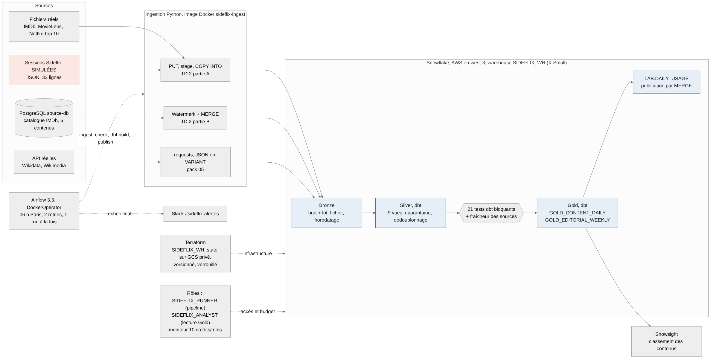
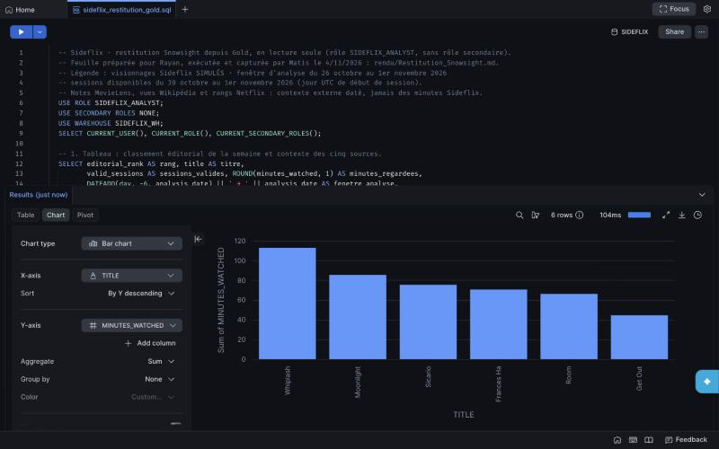

# Sideflix: a data pipeline for an independent streaming platform

"Oral Defense" project for the Data Engineering & Cloud Infrastructure course, Albert School, group 6: Matis Douay, Jérémy Caillaud, Rayan Faher Bonne. Oral defense on 6 November 2026.

## The business need

Sideflix is a **fictional** streaming platform, inspired by the real Netflix and specialized in independent cinema (assumptions: 10,000 subscribers at €7.99 per month, 100 content items, 6 employees; a sale to Netflix is the exit envisaged in the scenario).

- **User**: the catalog manager.
- **Decision**: which content to feature this week.
- **Cadence**: computed every day at 06:00 (Paris time), figures available before 07:00.
- **Grain**: content × UTC day of session start.
- **Metrics**: distinct valid sessions and minutes watched (sum of seconds / 60), seven-day ranking, with the real context from external sources displayed alongside and never mixed into the rank.

## Architecture as executed



| Component | Role | Course method |
| --- | --- | --- |
| PostgreSQL (`source-db`, container) | "On-premises" catalog database | Pack 04 |
| `ingestion/incremental_catalog.py` | Catalog to Bronze via watermark + MERGE | TD 2, part B |
| `ingestion/load_sessions.py` | Files and sessions via PUT, stage, COPY INTO; API via requests into VARIANT | TD 2, part A; pack 05 |
| Snowflake (AWS eu-west-3) | Bronze, Silver, Gold; X-Small SIDEFLIX_WH warehouse | TD 2, 3.2, 3.3 |
| dbt (`dbt/sideflix_dbt`) | 9 Silver views (quarantine, deduplication), 2 Gold tables, 21 tests | TD 3.2, 3.3; packs 03 and 07 |
| Docker + Airflow (`docker/`, `airflow/`) | `sideflix_daily` DAG: ingest, check, dbt build, publish; Slack alert | TD 4.2; packs 06 and 07 |
| Terraform (`terraform/`) | SIDEFLIX_WH warehouse; state in a private, versioned, locked GCS bucket | TD 4.2; pack 09 |
| `governance/` | SIDEFLIX_ANALYST and SIDEFLIX_RUNNER roles, service user, budget monitor | TD 2 |

Details: [docs/architecture_v2.md](docs/architecture_v2.md).

## The data

Five **authentic** datasets, each with URL, SHA-256 checksum, period, grain and terms of use in [`source/sources_manifest.csv`](source/sources_manifest.csv); details in [docs/sources_and_catalogue.md](docs/sources_and_catalogue.md).

| Dataset | Use | Period |
| --- | --- | --- |
| IMDb | Title, type, year, runtime of the six works | Snapshot of 4 Nov 2026 |
| MovieLens | 74 ratings: average and count per work | 1996 to 2018 |
| Netflix Top 10 | Weekly ranks; one confirmed match (Sicario) | Week of 9 Mar 2025 |
| Wikidata | Identity (QID), IMDb and Wikipedia links | Response of 4 Nov 2026 |
| Wikimedia | Wikipedia page views per day (42 observations) | 26 Oct to 1 Nov 2026 |

The **Sideflix sessions are simulated** (`source/v2/sessions/`, 32 rows over three days) and do not count among the five datasets. The expected result, computed independently, is in `source/v2/expected_daily_usage.csv`. The raw snapshots (`source/real/`) allow an exact replay. They stay in this private repository, with read access granted to the professor for grading: the IMDb and Netflix terms do not allow their redistribution, so the repository is not made public as long as these exports are in it, history included.

## Running the pipeline

Prerequisites: Docker Desktop, Python 3.11 or later, a Snowflake account with an RSA key pair per user (`gen_key.py` from TD 2), a Slack webhook (Incoming Webhook) for alerts, Terraform 1.9 or later and access to the state's GCS bucket for any Terraform operation.

1. **Snowflake objects** (once): `ingestion/00_create_sideflix_objects.sql` (database and schemas, SYSADMIN role), `terraform init` then `terraform plan` in `terraform/` (warehouse; see `terraform/README.md`), `ingestion/01_bronze_setup.sql` then `ingestion/04_bronze_v2_setup.sql` (Bronze), and as ACCOUNTADMIN `governance/10_admin_setup.sql` then `governance/10b_pipeline_user.sql` (roles, monitor, service user).
2. **Private configuration**: copy `airflow/.env.example` to `airflow/.env` and fill in the account, the user (`SIDEFLIX_PIPELINE`), the folder holding its key, the absolute paths of the repository and of `airflow/work`, and the webhook URL. This file is never committed.
3. **Images and services**:

```sh
docker build -f docker/ingestion.Dockerfile -t sideflix-ingest:1.0.0 .
docker build -f docker/dbt.Dockerfile -t sideflix-dbt:1.0.0 .
docker compose -f airflow/docker-compose.yml up -d --build
docker compose -f airflow/docker-compose.yml exec airflow /entrypoint airflow dags list-import-errors
```

4. **Demo run**: at http://localhost:8080, enable `sideflix_daily` and trigger it with the configuration `{"date":"2026-11-01"}` (or `airflow dags trigger sideflix_daily --conf '{"date":"2026-11-01"}'` via `/entrypoint`). The simulated sessions cover 30 October to 1 November: a scheduled run for any other day deliberately fails at the source check, without publishing anything.
5. **Check** in Snowsight:

```sql
SELECT usage_date, SUM(valid_sessions) AS sessions, SUM(minutes_watched) AS minutes
FROM SIDEFLIX.GOLD.GOLD_CONTENT_DAILY WHERE usage_date = '2026-11-01' GROUP BY 1;   -- 13 sessions, 177.4 minutes
SELECT * FROM SIDEFLIX.LAB.DAILY_USAGE ORDER BY usage_date;                        -- one row per date
SELECT * FROM SIDEFLIX.GOLD.GOLD_EDITORIAL_WEEKLY ORDER BY editorial_rank;          -- ranking and context
```

The lineage is generated with `dbt docs generate --project-dir dbt/sideflix_dbt --profiles-dir dbt/profiles-core`; graph: [docs/dbt_lineage.png](docs/dbt_lineage.png). Stop, resume and cleanup: [governance/README.md](governance/README.md).

## Results and reliability

- **Ranking as of 1 November**: Whiplash on top (7 sessions, 112.7 minutes), ahead of Moonlight, Sicario, Frances Ha, Room and Get Out. The 14 content/day rows are identical to the independent calculation.
- **Snowsight reporting** (analyst role, read-only on Gold): ranking table with the dated source context, bar chart and daily check (30 sessions, 454.2 minutes over the window). Screenshots and queries: [rendu/Restitution_Snowsight.md](rendu/Restitution_Snowsight.md).



*Simulated Sideflix viewing: analysis window from 26 October to 1 November 2026, sessions available from 30 October to 1 November 2026. The external context (ratings, page views, Top 10) is not counted in minutes.*

- **Quality**: `dbt build` 33/33 (11 models, 21 tests), freshness 2/2, reconciliation 32 = 30 valid + 1 quarantined + 1 duplicate.
- **Replay**: rerunning the same date adds no rows and leaves a single publication per date.
- **Incident 1**: an invalid `device` value (isolated copy) makes the test fail, blocks Gold and publication, and triggers the Slack alert; recovery by removing only the test batch.
- **Incident 2**: a crash after the write is caught by the retry; the MERGE keeps a single row per date.
- **Security**: the pipeline runs as the service user `SIDEFLIX_PIPELINE` with the `SIDEFLIX_RUNNER` role only; the analyst role reads Gold and nothing else; no secrets in Git or in the images.
- **Costs**: 1.44 credits actually consumed (development and testing included); about 1.5 credits per month projected for a daily run; monitor set to 10 credits per month (alerts at 50% and 80%, stop at 100%).

All evidence: [rendu/INDEX_PREUVES.md](rendu/INDEX_PREUVES.md).

Pipeline video (1 min 21 s, no sound): [run of the `sideflix_daily` DAG for 1 November](Enregistrement%20de%20l%E2%80%99e%CC%81cran%202026-11-04%20a%CC%80%2020.47.48.mov), recorded on Matis's Mac. It shows the ingestion, the source check and `dbt build` succeeding; the publication is still in progress at the end of the recording. Gold was rebuilt by this run at 19:48:51 UTC, with unchanged values.

## Manual steps and limitations

- Manual: Snowflake account and RSA key per user, Slack webhook, GCS bucket for the state, enabling the monitor's email notifications in Snowsight, inviting the professor with read access to this private repository (by its owner).
- Limitations: simulated sessions over three days; historical or dated external sources; a single Netflix match; two cloud providers (AWS for Snowflake, GCS for the Terraform state only); Snowflake trial account.

## Contributions

See the end of [rendu/INDEX_PREUVES.md](rendu/INDEX_PREUVES.md) and the Git history. Internal work log: [docs/journal_interne.md](docs/journal_interne.md).
