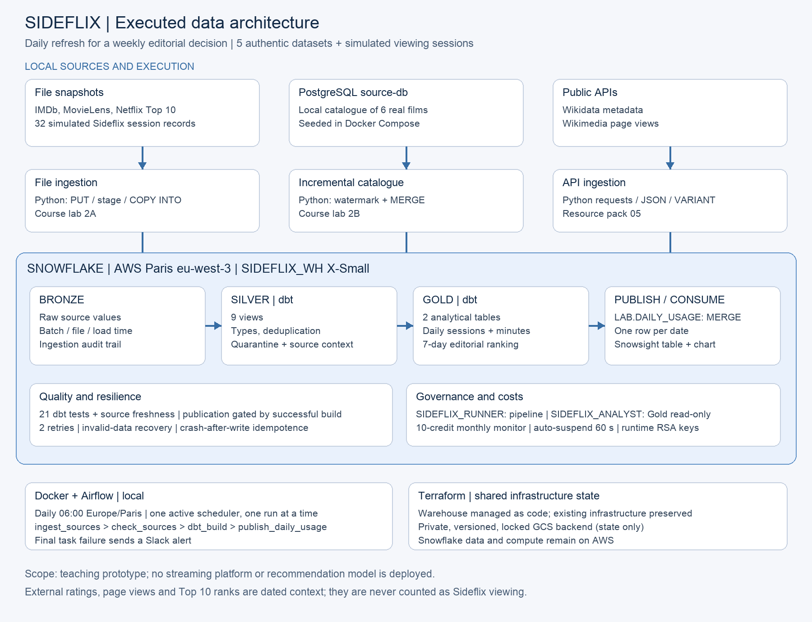
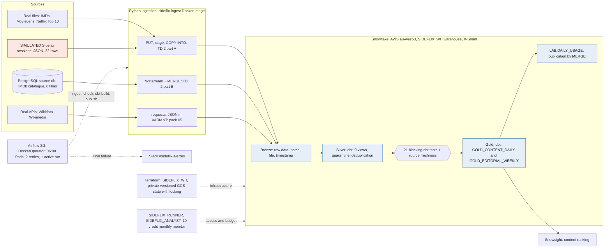

# Architecture v2: executed pipeline, 4 November 2026

The catalogue manager uses valid sessions and minutes per content item and UTC day, plus a seven-day ranking. Public sources provide real context; their observations are never treated as Sideflix viewing sessions.

The editable diagram is [architecture.mmd](architecture.mmd):

PostgreSQL, input files, Docker and Airflow run locally. Snowflake stores and processes the data on AWS in Paris. Airflow is the sole scheduler; publication depends on successful checks and uses a MERGE. Each run has an explicit date or interval and run ID, task logs, and an alert on final failure. Terraform manages the existing warehouse; its state uses a private, versioned GCS backend with locking. Google Cloud holds only the state; pipeline data stays in Snowflake on AWS.

Daily batch processing supports a weekly editorial decision. A watermark captures PostgreSQL changes, stage/COPY handles files, and requests/JSON handles APIs. These are methods from the TDs and resource pack. Gold reads Silver, aggregates context before joining, and retains source periods and provenance. Context is matched through IMDb and Wikidata identifiers; Netflix Top 10 has no identifier, so its only confirmed match, Sicario, uses the exact title. Simulation and data freshness are explicitly labelled.

File and API batch IDs are content hashes: a batch already in Bronze is not reloaded and a partial batch stops the run. Silver quarantines sessions with a missing identifier, unknown content, an invalid start time or a duration that is not positive or exceeds the runtime, and keeps one row per `session_id`; an unexpected device value is not quarantined but fails an `accepted_values` test. The test node of the Mermaid diagram is simplified: the `dbt_build` task runs source freshness, then `dbt build` runs 19 tests on the Silver views, builds each Gold table only after the Silver tests whose models are all upstream of it have passed (a failure skips that table), and runs the two Gold reconciliation tests once Gold is rebuilt. Source freshness is read from the ingestion journal `BRONZE.PUBLIC_SOURCE_RUNS`, so replays of a past date stay valid. Any failure stops the run before publication. The generated lineage, model and test documentation is in [docs/dbt/](dbt/README.md).

The diagram shows only components that were actually executed; their run evidence is indexed in [evidence/README.md](../evidence/README.md). PostgreSQL is the Compose service `source-db` (pack 04). Airflow runs the pipeline with the limited `SIDEFLIX_RUNNER` role; the service account is `SIDEFLIX_PIPELINE`. Manual prerequisites are a Snowflake account and RSA key per user, the group Slack webhook in the private `.env`, the Terraform state bucket, and monitor email notification settings in Snowsight.

## Proportionate choices and alternatives

Reloading the full catalogue would be simple for six titles. Watermark/MERGE applies TD 2B and transfers only changes; it requires a reliable `updated_at` and does not handle deletions in this prototype. Stage/COPY suits file snapshots; requests/VARIANT retains API responses before Silver typing. These methods cover three source forms; a weekly decision does not require streaming.

Snowflake Tasks could schedule the SQL steps inside the warehouse with fewer components, but the PostgreSQL catalogue runs locally and is not reachable from Snowflake, and the API collection would need an external access integration; Airflow with DockerOperator follows TD 4.2 and runs every step in a container with retries, run IDs and a failure callback, at the cost of a local scheduler that must stay running. Stored procedures or plain SQL scripts could replace dbt, but dbt adds ref-based lineage, generic and singular tests and generated documentation for the same SQL. BigQuery, covered in the course, is an alternative for cloud storage and compute. Snowflake was chosen because the TDs and group account already provide stage/COPY, SQL/VARIANT, RSA authentication and dbt. Switching would require adapting these components without a demonstrated benefit at this scale. Silver views and rebuilt Gold tables remain proportionate to the volume.

The data pipeline uses AWS through Snowflake. GCS holds Terraform state only; this auxiliary second provider must be disclosed when discussing the checklist's “1 cloud” wording. The project adds no Kafka, CDC, Iceberg, clustering or recommendation engine.
