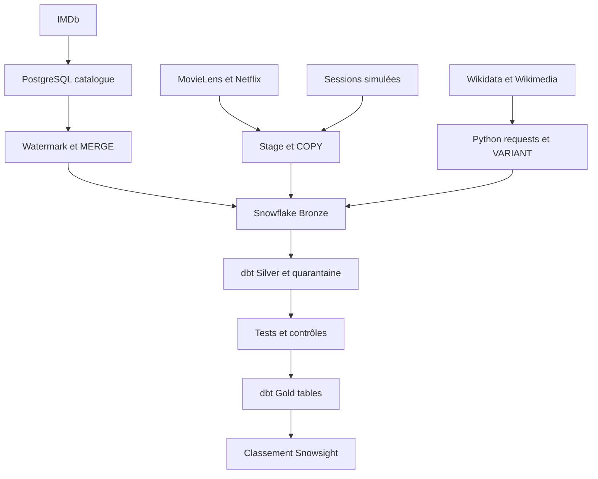

# Architecture v2 — conception

Conserve le cas d’usage : sessions valides et minutes par contenu/jour UTC, classement sur sept jours pour le responsable du catalogue. Les sources publiques ajoutent du contexte réel ; elles ne deviennent pas des sessions Sideflix.

PostgreSQL, fichiers, Docker et Airflow restent locaux. Snowflake stocke et calcule sur AWS Paris. Airflow demeure l’unique ordonnanceur ; la publication dépend des contrôles et utilise un MERGE. Date/intervalle et run_id explicites, journaux et alerte sur échec final. Terraform réutilise le warehouse existant ; protection du backend distant à compléter.

Batch quotidien adapté à une décision hebdomadaire ; watermark pour les changements PostgreSQL ; COPY pour fichiers ; requests/JSON pour APIs. Méthodes des TD et du pack, sans Kafka/CDC/Iceberg supplémentaire. Gold lit Silver, préagrège les contextes avant jointures et conserve périodes/provenance. Affichage clair de la simulation et de la fraîcheur.

État : conception préparée ; ingestion cloud des cinq sources, nouveaux modèles et contrôles non encore réalisés. Le prototype existant reste conservé jusqu’à intégration contrôlée. Valider le schéma contre la réalisation avant remise.
