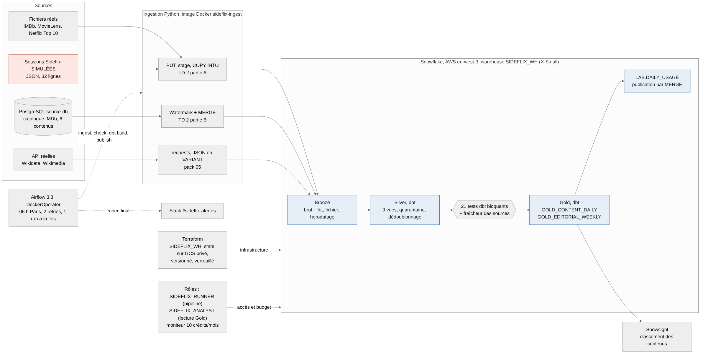
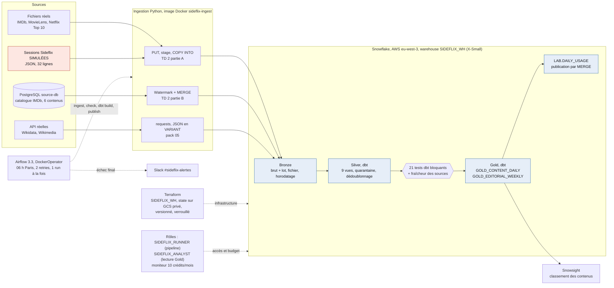

# Architecture v2 : pipeline réellement exécuté (4 novembre 2026)

Conserve le cas d’usage : sessions valides et minutes par contenu/jour UTC, classement sur sept jours pour le responsable du catalogue. Les sources publiques ajoutent du contexte réel ; elles ne deviennent pas des sessions Sideflix.

Source du schéma (Mermaid, `architecture_v2.mmd`) :

PostgreSQL, fichiers, Docker et Airflow restent locaux. Snowflake stocke et calcule sur AWS Paris. Airflow demeure l’unique ordonnanceur ; la publication dépend des contrôles et utilise un MERGE. Date/intervalle et run_id explicites, journaux et alerte sur échec final. Terraform réutilise le warehouse existant ; son state est stocké sur un backend GCS privé, versionné et verrouillé (Google Cloud ne sert qu'au state, les données restent dans Snowflake sur AWS).

Batch quotidien adapté à une décision hebdomadaire ; watermark pour les changements PostgreSQL ; COPY pour fichiers ; requests/JSON pour APIs. Méthodes des TD et du pack, sans Kafka/CDC/Iceberg supplémentaire. Gold lit Silver, préagrège les contextes avant jointures et conserve périodes/provenance. Affichage clair de la simulation et de la fraîcheur.

État au 4 novembre 2026 : schéma mis à jour d'après les composants réellement exécutés (étapes 5 à 10). La base source PostgreSQL est le service `source-db` du Compose (méthode du pack 04). Le pipeline tourne dans Airflow sous le rôle limité SIDEFLIX_RUNNER (utilisateur de service SIDEFLIX_PIPELINE). Étapes manuelles et prérequis : compte Snowflake et clé RSA par utilisateur, webhook Slack du groupe dans le `.env` privé, bucket GCS du state Terraform, notifications e-mail du moniteur dans Snowsight.

## Choix et alternatives à ce volume

Un rechargement complet du catalogue serait une alternative simple pour six œuvres. Le watermark/MERGE est retenu pour mettre en application le TD2B et ne transférer que les modifications ; sa limite est le besoin d'un updated_at fiable, sans gestion des suppressions dans ce prototype. Le stage/COPY convient aux snapshots fichiers ; requests/VARIANT conserve les réponses API avant typage en Silver. Ces méthodes répondent à trois formes de sources, sans flux streaming nécessaire à une décision hebdomadaire.

BigQuery, présenté dans les supports, constitue une alternative de stockage/calcul cloud. Snowflake est retenu parce que les TD et le compte du groupe fournissent déjà stage/COPY, SQL/VARIANT, RSA et dbt ; changer de plateforme demanderait d'adapter ces éléments sans bénéfice démontré pour ce petit cas. Les vues Silver et tables Gold reconstruites restent proportionnées au volume ; aucun clustering, moteur de recommandation ou composant streaming ajouté. Le traitement des données utilise AWS via Snowflake ; GCS conserve uniquement le state Terraform, ce qui est une limite explicite à la formulation «1cloud» de la checklist.
