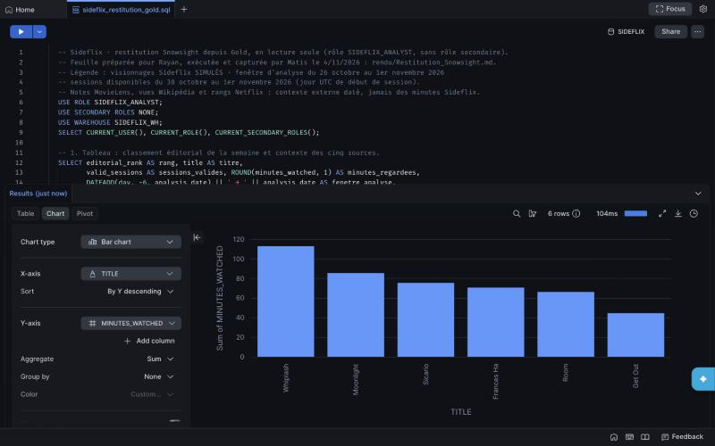
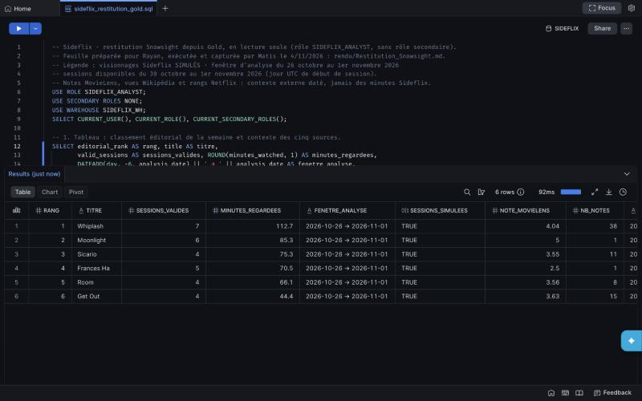
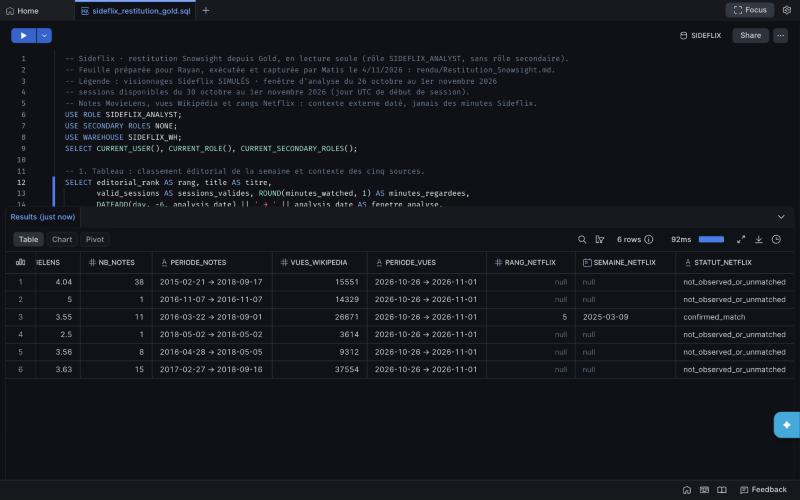
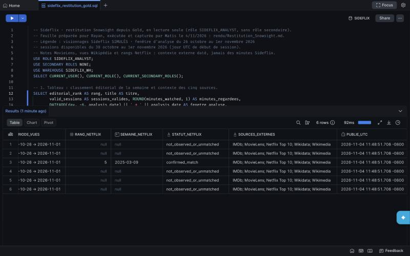
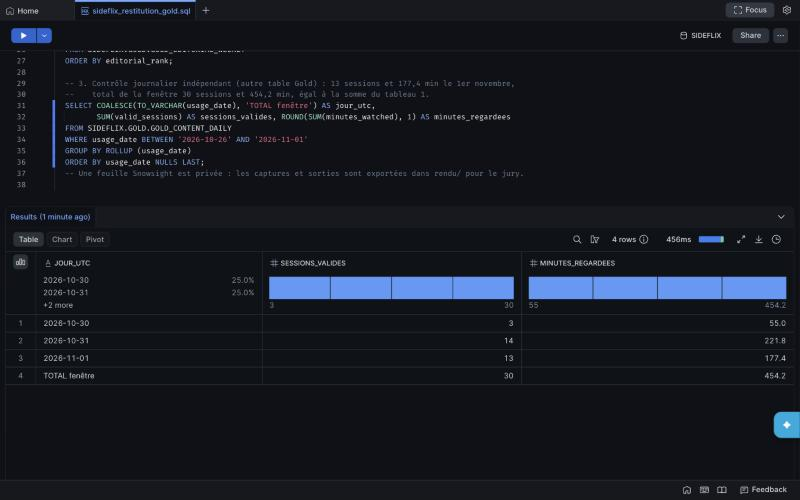

# Snowsight reporting — Gold table and chart

4 November 2026, 22:30 Paris. Snowsight Workspaces file `sideflix_restitution_gold.sql`, executed with **SIDEFLIX_ANALYST only** (`USE SECONDARY ROLES NONE`, read-only Gold access), warehouse SIDEFLIX_WH. Reproducible queries: [`docs/snowsight_gold_report.sql`](../../docs/snowsight_gold_report.sql). Exact outputs from the same execution, including query IDs: [`snowsight_sql_receipt.json`](snowsight_sql_receipt.json). A Snowsight worksheet is private; these screenshots export the results for the jury.

**Legend.** Sideflix viewing is **simulated**. Analysis window: 26 October–1 November 2026; sessions exist from 30 October–1 November (UTC session-start day). MovieLens ratings, Wikipedia pageviews and Netflix ranks are dated external context beside the rank. They are not Sideflix minutes and do not affect the ranking.

## Chart — minutes watched by content

Bars: X=`TITLE`, Y=`MINUTES_WATCHED`, descending order. Snowsight applies Sum to one row per title, so the displayed value is Gold's value.

## Table — editorial ranking and source context

| Rank | Title | Valid sessions | Minutes | MovieLens rating (count, period) | Wikipedia views (26 Oct–1 Nov) | Netflix Top 10 |
| --- | --- | ---: | ---: | --- | ---: | --- |
| 1 | Whiplash | 7 | 112.7 | 4.04 (38, 2015–2018) | 15,551 | Not observed or not matched |
| 2 | Moonlight | 6 | 85.3 | 5.00 (1, 2016) | 14,329 | Not observed or not matched |
| 3 | Sicario | 4 | 75.3 | 3.55 (11, 2016–2018) | 26,671 | Rank 5, week of 9 March 2025, confirmed match |
| 4 | Frances Ha | 5 | 70.5 | 2.50 (1, 2018) | 3,614 | Not observed or not matched |
| 5 | Room | 4 | 66.1 | 3.56 (8, 2016–2018) | 9,312 | Not observed or not matched |
| 6 | Get Out | 4 | 44.4 | 3.63 (15, 2017–2018) | 37,554 | Not observed or not matched |

Rank follows minutes watched. For the catalog manager, Whiplash is the first candidate to feature. Get Out has the most Wikipedia views but ranks last in Sideflix minutes: external context does not replace platform usage. Six items and three simulated days illustrate a decision without statistical significance.

`PUBLIE_UTC` (captured alias of `published_at_utc`) is Gold's build timestamp. Snowsight displays it in the session timezone (11:48:51 −08:00), equivalent to 19:48:51 UTC. Gold was rebuilt by video run `manual__2026-11-04T19:47:52` with values identical to the reference.

## Independent daily check

| UTC day | Valid sessions | Minutes |
| --- | ---: | ---: |
| 2026-10-30 | 3 | 55.0 |
| 2026-10-31 | 14 | 221.8 |
| 2026-11-01 | 13 | 177.4 |
| Window total | 30 | 454.2 |

Recalculated from the other Gold table, GOLD_CONTENT_DAILY. All three days match the expectation calculated outside Snowflake (`source/v2/expected_daily_usage.csv`). The total matches the table before rounding (30 sessions, 454.2 minutes; its displayed one-decimal per-title values sum to 454.3), and the reconciliation's 30 valid sessions (32 raw = 30 valid + one quarantined + one duplicate). No simulated session exists from 26–29 October.

## Execution and limitations

Queries were prepared for Rayan (group assignment on 4 November at 19:50), then executed and captured by Matis Douay in a Claude Code-assisted session. Reporting did not rerun the pipeline: read-only Gold access. Screenshots are 800 pixels wide (browser panel); exact values are in the JSON. Screenshot labels, SQL comments and query aliases are kept as captured, even where they are in French; the Snowsight interface itself is in English.
