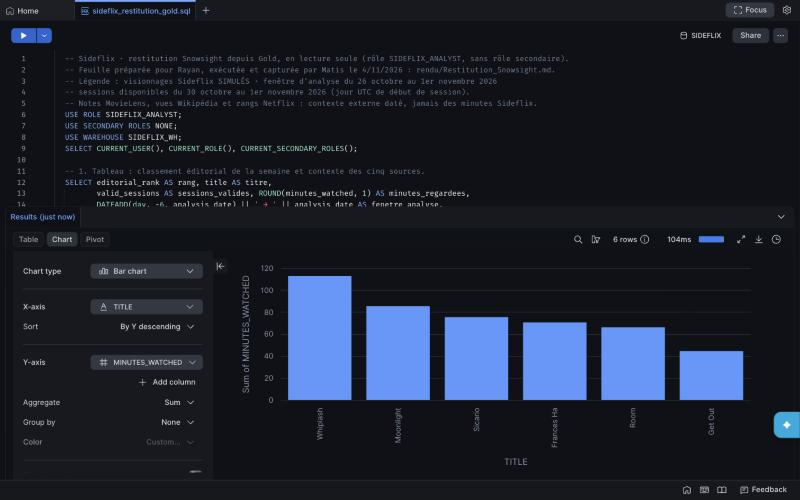
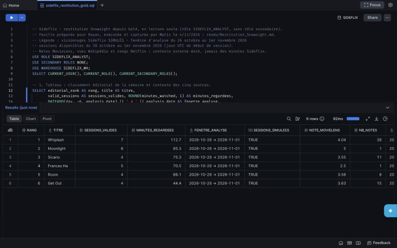
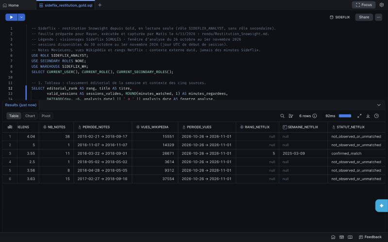
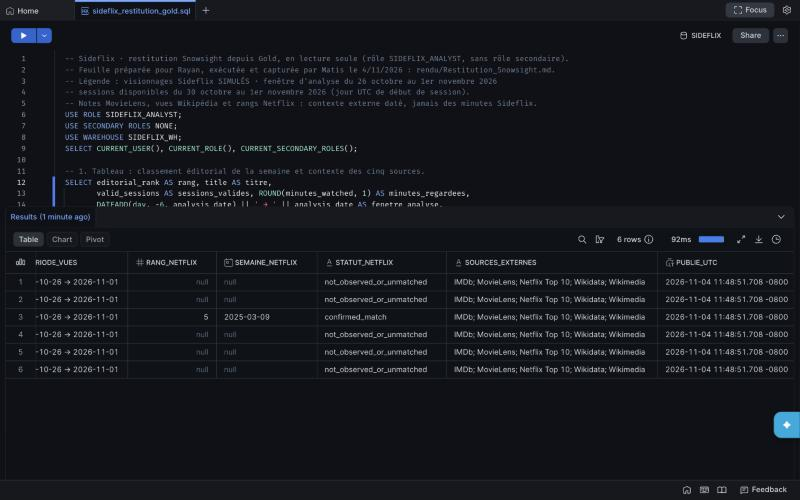
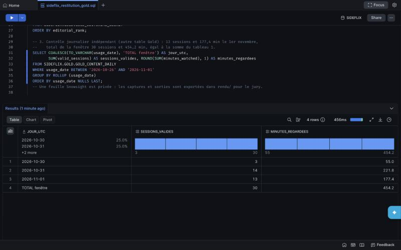

# Restitution Snowsight : tableau et graphique depuis Gold

4 novembre 2026, 22 h 30 (Paris). Feuille Snowsight `sideflix_restitution_gold.sql` (Workspaces) exécutée sous le seul rôle `SIDEFLIX_ANALYST` (`USE SECONDARY ROLES NONE`, lecture de Gold uniquement), warehouse `SIDEFLIX_WH`. Requêtes reproductibles : [`docs/snowsight_rayan.sql`](../docs/snowsight_rayan.sql). Sorties exactes de la même exécution, avec identifiants de requête : [`Restitution_SQL_Verification.json`](Restitution_SQL_Verification.json). Une feuille Snowsight est privée : les captures ci-dessous en sont l’export pour le jury.

**Légende.** Visionnages Sideflix **simulés**. Fenêtre d’analyse du 26 octobre au 1er novembre 2026 ; sessions disponibles du 30 octobre au 1er novembre 2026 (jour UTC de début de session). Les notes MovieLens, les consultations Wikipédia et les rangs Netflix sont un contexte externe daté, affiché à côté du rang : ce ne sont pas des minutes regardées sur Sideflix et ils n’entrent pas dans le classement.

## Graphique : minutes regardées par contenu

Barres, X = `TITLE`, Y = `MINUTES_WATCHED`, tri décroissant. Snowsight applique l’agrégat « Sum » sur une seule ligne par titre : la valeur affichée est celle de Gold.

## Tableau : classement éditorial et contexte des sources

| Rang | Titre | Sessions valides | Minutes | MovieLens : note (nombre, période) | Vues Wikipédia (26/10–1/11) | Netflix Top 10 |
| --- | --- | ---: | ---: | --- | ---: | --- |
| 1 | Whiplash | 7 | 112,7 | 4,04 (38, 2015–2018) | 15 551 | non observé ou non apparié |
| 2 | Moonlight | 6 | 85,3 | 5,00 (1, 2016) | 14 329 | non observé ou non apparié |
| 3 | Sicario | 4 | 75,3 | 3,55 (11, 2016–2018) | 26 671 | rang 5, semaine du 9/03/2025, appariement confirmé |
| 4 | Frances Ha | 5 | 70,5 | 2,50 (1, 2018) | 3 614 | non observé ou non apparié |
| 5 | Room | 4 | 66,1 | 3,56 (8, 2016–2018) | 9 312 | non observé ou non apparié |
| 6 | Get Out | 4 | 44,4 | 3,63 (15, 2017–2018) | 37 554 | non observé ou non apparié |

Le rang suit les minutes regardées. Lecture pour le responsable du catalogue : Whiplash est le premier candidat à la mise en avant ; Get Out, le plus consulté sur Wikipédia, reste dernier en minutes Sideflix, ce qui montre que le contexte externe ne remplace pas l’usage de la plateforme. Avec six contenus et trois jours simulés, le classement illustre la décision sans valeur statistique.

`PUBLIE_UTC` est l’horodatage de construction de Gold. Snowsight l’affiche dans le fuseau de la session (11:48:51 −08:00), soit 19:48:51 UTC : Gold a été reconstruit par le run Airflow `manual__2026-11-04T19:47:52` de la vidéo, avec des valeurs identiques à la référence.

## Contrôle journalier indépendant

| Jour UTC | Sessions valides | Minutes |
| --- | ---: | ---: |
| 2026-10-30 | 3 | 55,0 |
| 2026-10-31 | 14 | 221,8 |
| 2026-11-01 | 13 | 177,4 |
| Total fenêtre | 30 | 454,2 |

Recalcul depuis l’autre table Gold (`GOLD_CONTENT_DAILY`). Les trois jours sont identiques au résultat attendu calculé hors Snowflake (`source/v2/expected_daily_usage.csv`). Le total est égal à la somme du tableau avant arrondi (30 sessions, 454,2 minutes ; les minutes affichées, arrondies au dixième, totalisent 454,3) et aux 30 sessions valides de la réconciliation (32 lignes = 30 valides + 1 quarantaine + 1 doublon). Aucune session simulée n’existe du 26 au 29 octobre.

## Réalisation et limites

Requêtes préparées pour Rayan (attribution du groupe, 4/11 à 19 h 50), puis exécutées et capturées par Matis Douay (session assistée par Claude Code). Le pipeline n’a pas été relancé pour cette restitution : lecture seule de Gold. Les captures ont 800 px de large (panneau de navigateur) ; les valeurs exactes sont dans le JSON.
